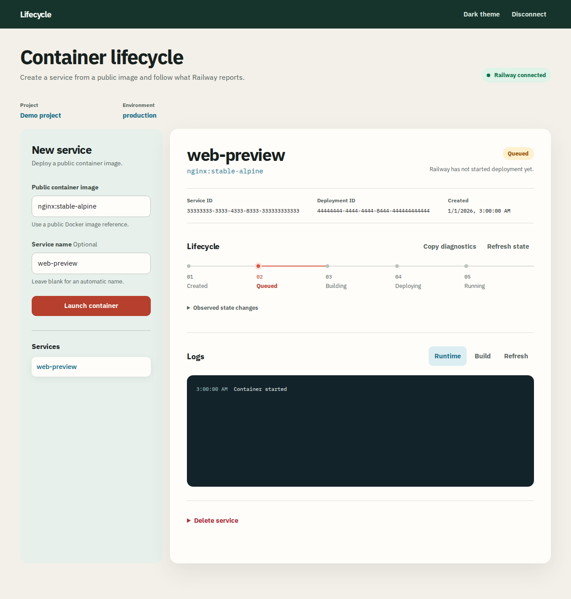

# Container Lifecycle Workbench

Lifecycle is a small UI for launching a public Docker image on Railway, reading the deployment state and logs, stopping the workload, restarting a crashed process, and deleting the service deliberately. It uses Railway as the source of truth. The application has no database.



## Local setup

Node 22 and pnpm are required.

```sh
pnpm install
cp .env.example .env
# Set SESSION_SECRET to 64 random hexadecimal characters.
# Set APP_ORIGIN to http://localhost:5173 for development.
pnpm dev:server
```

In another terminal, run `pnpm dev` and open `http://localhost:5173`. Generate a secret with `openssl rand -hex 32`. Use a Railway project token if possible. It is scoped to one environment. Account tokens offer project selection. A public image such as `nginx:stable-alpine` works for a demonstration.

The server keeps the token inside an AES-GCM encrypted, short-lived HttpOnly cookie. Disconnect expires the cookie. Do not paste a token into logs, screenshots, or issue reports.

## Checks

```sh
pnpm typecheck
pnpm lint
pnpm test
pnpm test:e2e
pnpm build
```

Browser tests use deterministic API responses and do not create Railway resources. The live path still requires an authenticated Railway project.

## Production deployment

For Railway, connect this repository to a new service. Build command: `pnpm install --frozen-lockfile && pnpm build`. Start command: `pnpm start`. Set `SESSION_SECRET` and `APP_ORIGIN` to the deployed HTTPS origin. Railway supplies `PORT`. Set `NODE_ENV=production` if the platform does not do so. The health route is `/api/health`.

For Cloudflare Pages, build with `pnpm build`, use `dist` as the output directory, and add `SESSION_SECRET` as a Pages secret and `APP_ORIGIN` as the exact Pages origin. For local Pages testing, put those two values in an ignored `.dev.vars` file, then run `pnpm pages:dev`. The shared BFF is mounted through `functions/api/[[path]].ts`.

The Cloudflare Pages mirror is live at https://lifecycle-workbench.pages.dev/. Railway deployment is pending an active plan: the authenticated CLI rejected creation of an isolated project because the workspace trial has expired. See `docs/CHECKLIST.md` for the verified deployment state and remaining live smoke test.

No live deployment is claimed in this repository. The current CLI login is expired. See [the execution checklist](docs/CHECKLIST.md) for live verification still required.

## Review path

1. Connect with a project token.
2. Launch a public image and inspect Railway's queued, deploying and running states.
3. Read build and runtime logs. Stop the deployment and observe Railway confirm removal.
4. Inspect the restart action when Railway reports a running or crashed deployment.
5. Copy diagnostics, then type the exact service name to delete it.

The main boundaries are [the API contract](docs/API_CONTRACT.md), [architecture](docs/ARCHITECTURE.md), [engineering requirements](docs/ERD.md), and [security review](docs/SECURITY.md). The [phone view](docs/screenshots/deployment-mobile.png) gives logs most of the available height.
