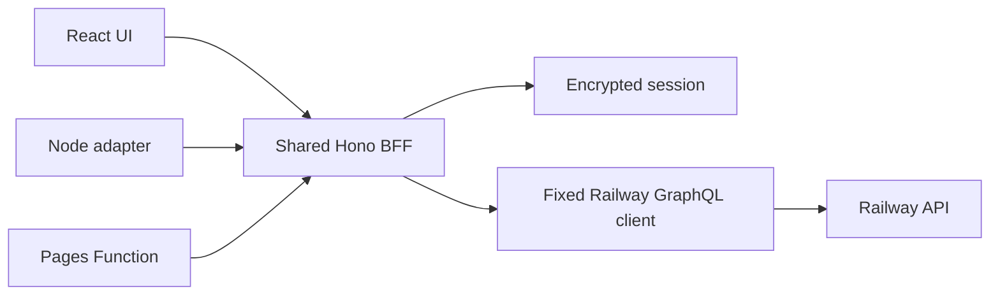

# Architecture

`src/shared` holds validation, deployment state and diagnostic redaction. `src/client` owns UI and TanStack Query cache. `src/server/app.ts` defines routes and access checks. `src/server/railway.ts` is the only GraphQL transport. `server/index.ts` and `functions/api/[[path]].ts` adapt the same BFF to Node and Pages.

No application database is needed. Project, environment, service, deployment and log data come from Railway. The browser keeps no Railway credential or sensitive Railway state in persistent storage. Its only local preference is theme. The server encrypts the token in an expiring HttpOnly cookie. Clearing the cookie disconnects the user, and the client clears its query cache.

The UI polls deployment and logs every two minutes and offers manual refresh. Railway's free API limit is low, so the implementation avoids per-second polling. The BFF caches project membership for five minutes. Each log response is bounded, and the client keeps at most 1,000 lines. A live session may still use extra requests when the user manually refreshes or switches services; its rate budget needs measurement with a real token.

The deployment timeline stores only states actually observed in the current browser session. It does not fabricate phase transitions or phase durations.
